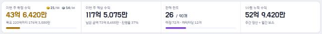
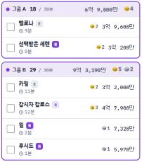
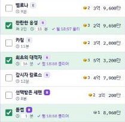

# 성찰기 — 결정석 장부 (메이플스토리 주간 보스 정산)

- 데모: https://gerudarudal.github.io/vibe-coding-HyeonHu/
- 저장소: https://github.com/gerudarudal/vibe-coding-HyeonHu
- 발표자료(PDF): [docs/발표자료_전현후.pdf](docs/발표자료_전현후.pdf)
- 도구: Claude Code (데스크톱 앱 Code 탭) 

---

## 1. 주제와 한 문장 규칙

> **메이플스토리 다캐릭 유저**가 **매주 본캐·부캐로 주간 보스를 돌고 정산할 때**, **캐릭터별로 잡은 보스를 체크하는 것만으로 캐릭터당 12개·월드당 90개 판매 한도를 반영한 이번 주 메소 수익(주급)과 큐브를 자동 계산**할 수 있게 한다.
> 기존에는 **수익 전체만을 보여주는 앱 밖에 없었고 캐릭터의 구조나, 시간과 관계없이 자동으로 계산한 정보 기반에서 내가 커스텀만 가능했다.**, 패치마다 가격과 한도가 바뀌고, 체크할 때마다 목록이 위로 튀는 등의 문제가 있었다. 추가적으로 다른 정산 앱은 잡을수 있다 없다 만을 판별하고, 내가 얼마나 진행했는지, 얼마를 더 벌 수 있는지, 등 진행상황에 따른 정보를 아예 알 수 없어 불편했다. `메이플스토리 다캐릭 보스를 돌 때 현실적인 도움이 되는 체크만 하면 계산되는 메이플 주급 장부`

### 하드 제약 점검
| 조건 | 결과 |
|---|---|
| 정적 웹 (GitHub Pages) | `index.html` 한 파일 (HTML·CSS·바닐라 JS, 외부 라이브러리 없음) |
| 백엔드 없음 | `localStorage` 저장 + JSON 파일 내보내기/가져오기 |
| 핵심 기능 1개, 화면 3개 이하 | 결정석 정산 / 대시보드 + 설정 창 (처음 3개였다가 "보스별" 화면을 사용자가 빼서 2개) |
| 금지 항목 | 로그인·결제·서버 없음. "도핑 묶음 **추천**"이라는 표현이 "추천 알고리즘 금지"로 오해될 수 있어 **"도핑 묶음 계산"**으로 문구 수정 (`3fc1019`) |

---

## 2. Phase 0 — 나이브 베이스라인

### 실제로 던진 프롬프트 (원문, 순서대로)
1. `메이플스토리 본캐랑 부캐 보스 돌고 결정석 정산하는 웹앱 만들어줘.`
2. `응 알아서 해줘`
3. `사용하기 편하게 알아서 더 개선시켜줘`
4. `알아서 더 개선시켜줘`
5. `알아서 더 개선해줘` (이후 CLAUDE.md 작성으로 넘어감)

### AI가 묻지 않고 임의로 결정한 것
| 항목 | AI의 결정 | 문제 |
|---|---|---|
| 배포·저장 방식 | claude.ai **Artifact**로 배포하고, **계정 DB(서버 저장)** 로 기기 간 동기화 | 과제 하드 제약 위반 (정적 웹·백엔드 금지) — 나는 이걸 요청한 적이 없음 |
| 게임 데이터 | **AI가 기억하던 옛날 결정석 가격**과 **월드당 180개, 캐릭터당 14개** 한도를 그대로 넣음 | 실제로는 2026-09-17 패치 기준 90개·12개. "알아서 해줘" 단계에서 웹 검색으로 바로잡혔지만, 첫 결과물은 틀린 숫자로 계산하고 있었음 |
| 디자인 | 보라·다크 팔레트, 폰트(Do Hyeon / IBM Plex), 카드 레이아웃 | 결과적으로 마음에 들어 이후에도 유지 (→ 비개입 사례) |
| 기능 범위 | "개선해줘" 3번에 월드 탭, 일일 보스 입력, 메소 시세(원화 환산), 보스별 체크판, 건너뛰기, 헛도는 보스 경고 등 **기능이 계속 늘어남** | 나중에 대부분 내가 직접 뺌 (일일 보스·시세·건너뛰기·헛도는 보스·보스별 화면) |
| 예시 데이터 | 예시 캐릭터 3명이 **모두 12개 한도를 초과**한 상태로 시작 | 첫 화면부터 경고가 떠 있었음 — AI가 직접 화면을 보고 나서야 발견 |

### 관찰
- "알아서"라고 하면 AI는 **기능을 더하는 방향**으로만 움직였다. 빼는 판단은 한 번도 하지 않았다.
- AI가 고른 **기술 스택(Artifact+DB)이 과제 제약과 정면으로 충돌**했는데, AI는 과제 제약을 모르니 당연한 결과였다. → Phase 1에서 CLAUDE.md 1번 항목을 "하드 제약"으로 둔 이유.
- 일단은 이 결과물을 보고도 깜짝 놀랐다. 기본적인 명령어 몇개만을 듣고 바로 수준높은 결과물을 내어 진짜로 마음만 먹으면 무엇이든 만들 수 있겠다는 생각이 들었지만, 이미 있는 웹 앱과 큰 차이가 거의 없는 성능에 조금 실망했다. 하지만 고칠 점과, 수정할 점, 새로 넣으면 좋을 것 같은 기능들이 마구 떠올라 기대되었다.

---

## 3. Phase 1 — CLAUDE.md

- 1차: AI에게 "지금까지의 요구사항과 규칙을 정리해줘"라고 시켜 초안을 받음 (Artifact 배포·계정 DB 기준이었음).
- 2차: **내가 직접 고쳐서** 과제 하드 제약(정적 웹, localStorage만, 화면 3개 이하, 로그인 금지)과 "한 번에 한 기능, 코드 전에 계획 먼저 + 승인" 규칙을 넣음.
  - 프롬프트 원문: `"수정된 CLAUDE.md를 확인해줘. 백엔드/DB 연동을 모두 제거하고, pure HTML/CSS/JS 단일 파일(index.html) 구조로 메인 정산 대시보드 레이아웃과 보스 데이터(BOSSES) 초기화 로직부터 시작하는 계획을 먼저 말해줘."`
- 이후 CLAUDE.md는 **결정이 생길 때마다 갱신되는 문서**가 됨 (보스 순서, 큐브 표, 디자인 톤, "체크해도 화면이 움직이지 않게" 규칙 등). 최종본은 저장소의 `CLAUDE.md` 참고.
- md에서는 원래 겪었던 진짜 문제점에 대한 해결책보다는, 그냥 이 정산앱을 만드는것에 너무 치우쳐진 상황이었기에, 이 부분에 손을 많이 대었다.

---

## 4. Phase 2 — 의사결정 지점

각 사례는 **상황 → 프롬프트 원문 → AI 출력/가정 → 나의 판단 → 전/후 결과 → 증거** 순서입니다.

### 사례 1. AI의 "기억"을 믿지 않고 게임 데이터를 검증하게 함
- **상황**: 결정석 가격과 판매 한도는 패치마다 바뀌는데, AI는 학습 시점의 값을 그대로 썼다.
- **프롬프트**: `응 알아서 해줘` (Phase 0 2번째 턴)
- **AI 출력**: 이번에는 웹 검색으로 2026-09-17 패치 가격을 찾아 바꿨고, 한도도 180→90개, 14→12개로 고쳤다. 사이트마다 **노말 칼로스 가격이 달랐는데(4억 7,900만 vs 5억 3,200만)**, 하나를 고르고 그 사실을 알려줬다.
- **판단**: 1차 CLAUDE.md(AI 초안)에 "가격이 바뀌면 웹 검색으로 확인하고, **출처가 엇갈리면 사용자에게 알린다**"는 규칙을 넣었다. 숫자 하나하나를 내가 다 확인할 수는 없으니, **불확실성을 숨기지 않게 하는 쪽**으로 통제했다. 다만 과제용으로 CLAUDE.md를 다시 쓰면서 이 규칙이 빠졌다는 걸 성찰기를 검토하다 알게 됐다.
- **전/후**: 월드당 180개 → 90개, 캐릭터당 14개 → 12개 (첫 결과물의 정산이 최대 2배 가까이 부풀려져 있었음)
- **증거**: 현재 CLAUDE.md "핵심 게임 규칙"(판매 한도 12개·90개), `index.html`의 `BOSSES` 배열 주석(2026-09-17 패치 기준 가격)

### 사례 2. AI가 숫자를 지어내지 않고 멈춘 경우 — 큐브 보상표 (비개입 → 내가 데이터 제공)
- **상황**: 보스 보상으로 받는 골드/실버 큐브도 반영하고 싶었다.
- **프롬프트**: `그리고 지금 메이플 보스는 결정석도 중요하지만, 돌고 나오는 골드, 실버, 브론드 큐브도 중요해 이것도 반영해줄래?`
- **AI 출력**: 공식 보상 페이지에서 **어떤 보스가 어떤 큐브를 주는지**는 찾았지만 **개수는 못 찾았다**고 하면서, "틀린 숫자를 넣으면 계산 전체가 틀려지니 지어내지 않겠다"며 멈추고 선택지를 줬다.
- **판단**: 게임 안 보상표를 캡처해서 직접 줬다. `B가 맞아 그리고 보스별 큐브표는 내가 줄게 그리고 큐브 표시할 때 이름 다적으면 너무 기니깐, 아이콘으로 해줘`
- **전/후**: 추측값 대신 실제 표 기준(`CUBE_DEF`). 이후 `걍 브론즈 에디셔널 큐브는 빼자 안중요한 보상이다`로 골드·실버만 표시.
- **증거**: `index.html`의 `CUBE_DEF`(사용자가 준 보상표를 그대로 옮긴 표, "표에 없는 보스·난이도는 0개" 주석), 표시 대상을 골드·실버로 줄인 `CUBE_SHOW=[2,1]`, CLAUDE.md "큐브" 항목
- **배운 점**: AI가 "모른다"고 말할 수 있게 한 것(사례 1의 규칙)이 여기서 효과를 봤다. 

### 사례 3. "버튼이 안 눌린다"는 증상과 실제 원인이 달랐다
- **상황**: 보스 편집에서 난이도 버튼이 안 눌리는 것 같았다.
- **프롬프트**: `이거 아까 보스편집할 때 안눌러지는 버그도 있었어 확인해줘`
- **AI 출력**: 바로 코드를 고치지 않고, ① 모든 버튼 위에 다른 요소가 덮여 있는지 `elementFromPoint`로 검사, ② 실제 마우스 클릭으로 시험한 뒤, **클릭은 정상이고 "캐릭터당 12마리" 제한에 막힌 것**이라고 진단했다. 예시 본캐가 딱 12개라, 새 보스를 누르면 화면 맨 아래 작은 토스트만 뜨고 아무 일도 없어 보였던 것.
- **판단**: AI의 진단을 받아들였다. "버그 수정"이 아니라 **"막혔다는 걸 보이게 하는 UX 수정"**이 맞다고 봤다.
- **전/후**: 전) 눌러도 반응 없음 → 후) 12개가 차면 안 고른 보스 버튼이 점선으로 흐려지고 "12마리 꽉 참" 안내, 막힌 버튼을 누르면 줄이 흔들림
- **증거**: `index.html`의 `.erow.locked` 스타일(안 고른 버튼을 점선으로 흐리게), 개수 줄의 "12마리 꽉 참 · 다른 보스를 고르려면 먼저 하나를 빼세요" 안내, 막힌 줄을 흔드는 `.nudge` 효과, CLAUDE.md "보스 편집 12마리 제한" 항목
- **배운 점**: 사용자가 말하는 "버그"를 AI가 그대로 코드 버그로 받아 고쳤다면 엉뚱한 곳을 건드렸을 것.

### 사례 4. AI가 "고쳤다"고 했지만, 진짜 원인은 내가 찾았다 — 체크할 때 화면 밀림
- **상황**: 보스를 체크할 때마다 화면이 살짝씩 움직였다.
- **프롬프트 1**: `캬 너무좋아 님아 근데 이거 체크하면 화면이 살짝씩 움직여 체크칸도 좀 크기나 이런걸 고정하자 어떻게 해결해봐 좋은 방법 있으면`
- **AI 출력 1**: 보스 줄에 분 입력칸이 새로 생기며 금액이 38px 밀리는 것을 측정으로 찾아 고쳤고, **"1345px·1060px·375px에서 1px도 안 바뀐다"**고 보고했다.
- **실제**: 내 화면에서는 여전히 움직였다.
- **프롬프트 2**: `님아 이거 이유를 찾았어  젤 위에 주 확정수익 예상수익 이부분에서 칸이 밀려 이거 바로 해결하도록 해`
- **원인**: 요약 바의 확정 금액 옆에 붙은 큐브가 **특정 화면 폭에서만** 줄바꿈되며 칸 높이가 바뀌었다. AI는 자기가 고른 3개 폭에서만 쟀기 때문에 놓쳤다.
- **판단(개입)**: AI의 "확인했다"를 믿지 않고 직접 써 보면서 원인 위치를 짚어 줬다.
- **전/후**: 전) 큐브가 금액 줄에 붙어 폭에 따라 줄바꿈 → 후) 큐브를 칸 제목 줄로 옮기고 금액 줄은 항상 한 줄. 검증 방식도 **620~1340px을 10px 간격으로 전부** 재는 것으로 바뀌었고, 이 확인 방법을 CLAUDE.md에 규칙으로 넣음.
- **증거**: `index.html`의 `.stat .lab.lab-c`(큐브를 금액 줄에서 칸 제목 줄로 옮긴 부분), CLAUDE.md "체크해도 화면이 움직이지 않게" 규칙(여러 화면 폭에서 체크 전후 요약 칸 높이를 재라는 확인 방법 포함), 스크린샷 `docs/screenshots/case4-after-summary.png`
- **배운 점**: AI가 "검증했다"고 할 때 **무엇을, 어떤 범위에서** 검증했는지 물어봐야 한다. 내가 여러 값을 입력하면서 변하는 모습을 찾지 못했다면 계속 이 버그는 유지됐을 것이다.

### 사례 5. AI의 과잉 설계를 세 번에 걸쳐 걷어냄 — 도핑 묶음
- **상황**: 도핑(30분 버프)을 아끼려고 시간이 짧은 보스들을 묶어 도는 기능 — 다른 정산 앱에 없는 차별점으로 기획.
- **AI의 설계 변화와 내 개입**
  1. AI: 보스 이름 앞에 **색깔 숫자 배지(1, 2, 3…)** + 주 단위로 묶음을 고정 + 이번 주 입력한 시간은 다음 주부터 반영
     - 나: `이거 숫자가 너무 눈에 띄어 ... 묶음 이라는 느낌이 안들고 걍 우선순위같은 느낌이라 개선할법 생각해봐` / `보통 파티보스는 개인보스처럼 버프를 아껴서 몰아서 돌지 않아 ... 파티보스는 묶지 않게끔`
  2. AI: 알파벳 태그 + **"클리어한 N개 빼고 다시 묶기" 버튼** + 주 단위 저장 계획(`S.plans`)
     - 나: `이거 클리어한거 빼고 다시 묶기 이런식으로 어렵게 나누지 말고, 그냥 도핑묶음 누르면 그때마다 새로 묶는걸로 해줘 지금 너무 쓰기 난해해`
  3. AI: 버튼을 누를 때마다 남은 보스로 새로 묶음 (저장 없음, 일반 목록의 태그도 제거)
     - 나: `이거 묶는거 색으로 묶지 말자 걍 다 같은색으로 묶자 색 갑자기 바뀌니깐 촌스러워` / `도핑a 말고 그룹A 이런느낌으로 가자`
- **판단**: 묶는 계산 자체(부분집합 DP로 도핑 횟수 최소화)는 **AI에게 맡겼고 그대로 받아들였다**(→ 비개입). 하지만 **"사용자가 어떻게 쓰는가"는 AI가 계속 복잡하게 만드는 쪽으로 틀렸다.** AI는 "돌던 중에 묶음이 바뀌면 헷갈릴 것"이라는 그럴듯한 가정을 세우고 그걸 막는 장치를 계속 덧붙였다.
- **전/후**: 저장 구조·다시 묶기 버튼·주 단위 계획·색 6가지 → 버튼 하나(누를 때마다 새로 묶기), 보라색 하나
- **증거**: `index.html`의 `freshBundle`(버튼을 누를 때마다 남은 보스로 새로 묶기)과 `packGroups`(부분집합 DP), 그룹 이름을 정하는 `groupName`, CLAUDE.md "도핑 묶음 짜는 시점" 항목(주 단위 저장·다시 묶기 버튼 없음), 스크린샷 `docs/screenshots/case5-after-groups.png`
- **배운 점**: 기능이 같은 자리에서 세 번 바뀌면 **설계 과잉 신호**. AI가 "예외 상황을 막는 장치"를 제안할 때마다 그 예외가 실제로 나한테 일어나는지 따져봐야 했다. 이 부분은 같이 게임을 하는 사람들에게도 검증을 하면 더 많은 데이터와 해결방안을 얻을 수 있을 것이다.

### 사례 6. 디자인 취향은 AI에게 맡기지 않았다 — 난이도 표시와 체크 칸
- **프롬프트 1**: `지금 보스 체크 칸부분을 좀 예쁘게 다듬어보자 너무 그냥 이름- 체크 이게 밋밋해` (+ 인게임 난이도 UI 캡처 첨부)
- **AI 출력**: 인게임 색(이지 은색·노말 청록·하드 분홍·카오스 금색·익스트림 빨강) 칩 + 둥근 커스텀 체크박스 + 보라 배경
- **프롬프트 2**: `이거 표시때매 너무 알록달록해졌어 이지는 그냥 E 노멀은 N 하드는 H 카오스는 C 익스는 EX 만 하고, 회색 연보라 보라 검정 바탕에 보라이런식으로 테마에 맞게 가자그리고 칸은 아까처럼 다시 돌려줘 이게 아까처럼 그냥 노트 느낌이 더 정갈하고 깔끔해서 좋네`
- **판단**: 참고 이미지를 줬더니 AI는 **색을 그대로 베꼈다**. 내 의도는 "느낌만 참고"였다. 의도를 이미지만으로 전달하면 AI는 문자 그대로 해석한다.
- **전/후**: 5가지 게임 색 + 커스텀 체크박스 → 약자(E/N/H/C/EX) + 보라 계열 단계 + 기본 체크박스
- **비개입 사례**: Phase 0에서 AI가 고른 **보라 테마와 폰트**는 처음부터 마음에 들어 끝까지 그대로 썼다.
- **증거**: `index.html`의 `DIFF_ABBR`(E·N·H·C·EX)과 `--d-easy-bg`~`--d-ext-bg` 색 토큰(회색 → 연보라 → 보라 → 검정+보라), CLAUDE.md "보스 체크 줄" 항목("알록달록한 인게임 색은 쓰지 않음"), 스크린샷 `docs/screenshots/case6-after-rows.png`

### 사례 7. 문법 검사로는 안 잡히는 오류 — 브라우저 확인의 필요성
- **상황 1**: 건너뛰기 기능을 고친 뒤 AI가 "문법 검사 통과"를 확인했지만, 화면이 아예 안 그려졌다. 지워진 변수(`doneN`)를 카드 아래쪽에서 아직 쓰고 있었던 것 (`node --check`는 문법만 보고 실행은 안 함). AI가 브라우저 콘솔을 보고 스스로 찾음.
- **상황 2**: 작은 버튼(`btn mini`)들이 이유 없이 늘어나 있었다. 상단 바 요약에 쓴 CSS 클래스 `.mini`가 작은 버튼 클래스와 **이름이 겹친 것**. "순서 바꾸기" 화면을 만들다 버튼이 화면 폭만큼 늘어난 걸 보고 발견.
- **판단**: AI가 수정마다 로컬 서버로 띄워 PC·모바일 화면을 확인하게 한 규칙(CLAUDE.md 검증 항목)이 둘 다 잡아냈다. 이후 CLAUDE.md에 "상단 바 요약은 `#mini`(id)로만 스타일" 규칙 추가.
- **증거**: CLAUDE.md "CSS 이름 주의" 항목, `index.html`의 `#mini{...}` 스타일(원래 `.mini`), 현재 코드에 `doneN` 변수가 남아 있지 않음

### 사례 8. 계획 승인 규칙 — 잘 지켜진 순간과 흐려진 순간
- CLAUDE.md 규칙: "코드를 작성하기 전에 반드시 변경 계획(Plan)을 제시하고 사용자의 승인을 받을 것"
- **잘 지켜진 예**: 보스 편집을 팝업으로 할지 물었을 때 AI가 표로 장단점을 비교하고 "대시보드 영역을 편집 화면으로 바꾸는 방식"을 추천 → `엉 진행해줘`. 내가 예전 앱에서 불편했던 점(`이전에 다른 보스 정산 앱을 사용할 땐, 창에 수정창이 있어서 매우 불편했어`)을 반영한 설계였다.
- **흐려진 예**: `남은 계획 진행하면 될것같아` 한 마디에 AI가 3~7단계를 한 번에 진행했다. 결과물은 좋았지만, "한 번에 한 기능" 규칙과 기능 단위 커밋은 지켜지지 않았다.
- **커밋**: AI는 매 단계 "추천 커밋 메시지"만 주고 실제 커밋은 하지 않았고, 나도 넘어갔다. 결국 git 기록은 마감 직전 `4103aa9` 한 번에 몰렸다. → CLAUDE.md 커밋 규칙을 "메시지 제안 → **확인하면 그 자리에서 실제 커밋**"으로 고침 (`3fc1019`).
- **증거**: 커밋 `4103aa9`(결과물 전체가 한 커밋), `3fc1019`(CLAUDE.md "커밋 단위" 규칙 수정), `git log`
- AI를 사용하는 프로젝트는 맨 처음 프롬프트에 대한 규칙을 정하는 기본적인 단계에서부터 신중하게 정해야 한다는 것을 깨달았다. 만약 이 과정이 없거나, 다른 선택을 했었다면 지금과는 사뭇 다른 결과물이 나왔을 것이다.

---

## 5. 다음 프로젝트에 바로 쓸 팁

1. **AI의 "확인했다"에는 범위를 물어라.** "어떤 화면 폭에서, 어떤 조작으로 확인했어?" — 사례 4에서 AI는 3개 폭만 쟀다. 측정 방법(예: 10px 간격 전수 측정)을 CLAUDE.md에 규칙으로 박아 두면 다음부터 알아서 그렇게 한다.
2. **증상을 원인으로 단정하지 마라.** "안 눌린다"는 클릭 버그가 아니라 피드백 부족일 수 있다(사례 3). AI에게 "고쳐줘" 대신 "원인부터 확인해줘"라고 시키는 게 안전하다.
3. **바뀌는 사실(가격·규칙)은 AI 기억 대신 출처를, 출처가 엇갈리면 보고하게.** 이 규칙 하나로 AI가 "모르면 멈추는" 행동까지 얻었다(사례 1→2).
4. **같은 기능이 세 번 바뀌면 설계 과잉 신호.** AI는 예외를 막는 장치를 덧붙이는 쪽으로 움직인다. 그 예외가 실제로 일어나는지 사용자 입장에서 따져라(사례 5).
5. **참고 이미지는 "무엇을 참고할지"까지 말해라.** 말하지 않으면 AI는 색까지 그대로 베낀다(사례 6).
6. **"추천 커밋 메시지"는 커밋이 아니다.** 규칙에 "확인하면 실제로 커밋"까지 써야 기록이 남는다(사례 8).
7. 같은 말을 듣거나, 할 때에도 AI가 중요하게 생각하는 가치와 사람이 생각하는 가치는 생각보다 많이 다르다. 이 부분을 매 프롬프트마다(혹은 제일 먼저 정의) 지정해줘야 할 필요가 있다.

---

## 6. 결론
이번 프로젝트에서 의도와 AI 출력 사이의 간극은 크게 세 곳에서 생겼다. 첫째는 AI가 모르는 것을 아는 척할 때다. 옛날 결정석 가격과 판매 한도를 학습된 기억으로 채워 넣었고, 과제 제약을 모르니 서버 저장 방식을 마음대로 골랐다. 둘째는 AI가 사용자의 사용 방식을 추측할 때다. 도핑 묶음에서 "돌던 중에 묶음이 바뀌면 헷갈릴 것"이라는 그럴듯한 가정을 세우고 저장 구조와 다시 묶기 버튼을 계속 덧붙였지만, 실제로 나는 버튼 하나면 충분했다. 참고 이미지를 줬을 때 색까지 그대로 베낀 것도 같은 종류라 생각한다. 셋째는 AI가 "확인했다"고 말할 때다. 자기가 정한 조건 안에서만 검증했기 때문에, 화면이 밀리는 진짜 원인은 내가 직접 써 보면서 찾아야 했다. 이 간극을 줄인 방법도 세 가지였다. 바뀌는 사실은 기억 대신 출처를 보게 하고 불확실하면 보고하게 하는 규칙을 CLAUDE.md에 넣었고, 그 결과 AI는 큐브 개수처럼 모르는 데이터 앞에서 지어내지 않고 멈췄다. 사용 방식과 디자인 취향처럼 내가 정답을 아는 영역은 AI 제안을 그대로 받지 않고 단순하게 되돌렸다. 검증은 AI의 보고를 마지막 단계로 두지 않고, 측정 범위를 묻고 그 방법까지 규칙으로 고정했다. 결국 AI에게 맡겨도 되는 것은 정해진 규칙 안의 계산과 구현이었고, 맡기면 안 되는 것은 무엇이 사실인지, 사용자가 실제로 어떻게 쓰는지, 무엇이 충분히 검증된 것인지에 대한 판단이었다. 이 부분을 항상 유의하여야 목적에 맞는 결과물을 내는데 방해가 되지 않을 것이다.

---

## 부록: 증거 체크리스트 (제출 전 채우기)
- [x] 커밋 해시: `4103aa9`(전체 결과물), `3fc1019`(문구·커밋 규칙 수정)
- [x] 사례 4 "후" — 큐브가 칸 제목 줄로 옮겨진 요약 바

  
- [x] 사례 5 "후" — 버튼 하나로 새로 묶은 "그룹 A / B" (보라색 하나)

  
- [x] 사례 6 "후" — 약자 난이도 칩(E·N·H·C) + 기본 체크박스

  
- [ ] "전" 화면들(Phase 0 Artifact 버전, 사례 4 큐브가 금액 옆, 사례 5 숫자 배지, 사례 6 알록달록 칩)은 코드가 바뀌어 다시 찍을 수 없음 → 대화 기록 속 캡처나 설명으로 대신
- [x] 웹앱을 만들 때 보낸 프롬프트 원문 전체 (Phase 0~2, 대화 내보내기에서 내가 보낸 메시지만 추출): [PROMPTS.md](PROMPTS.md)
